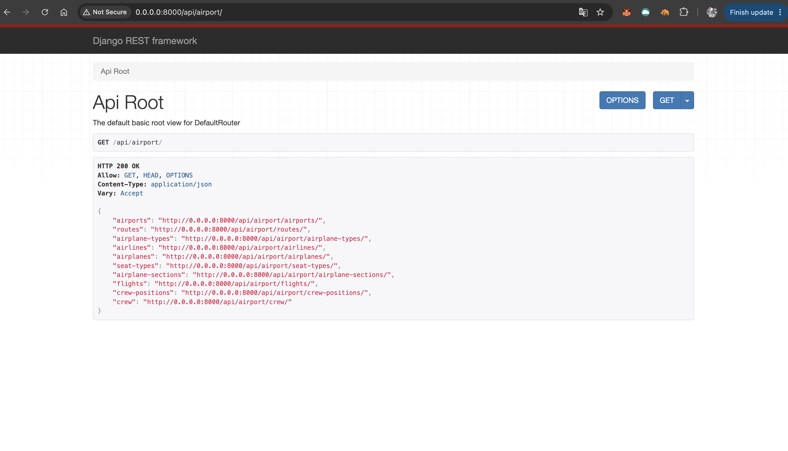
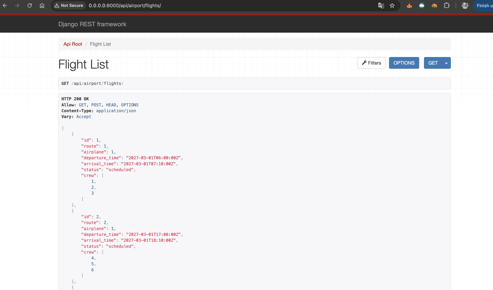
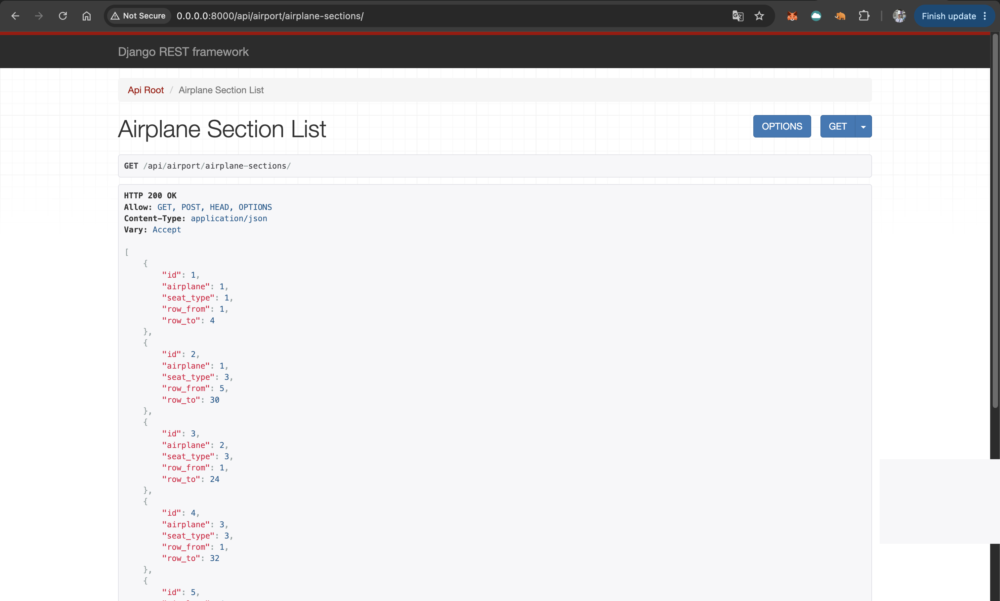
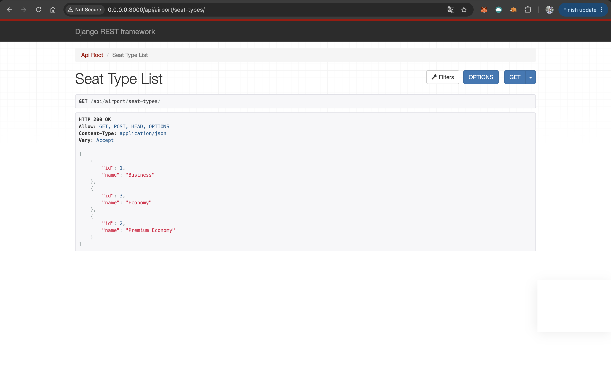
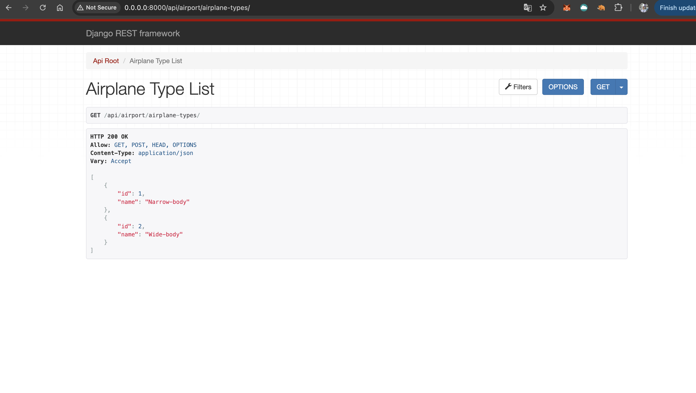
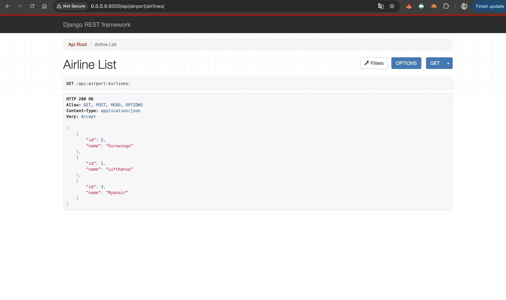
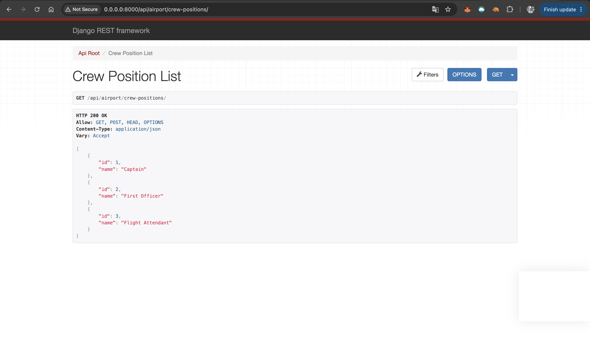
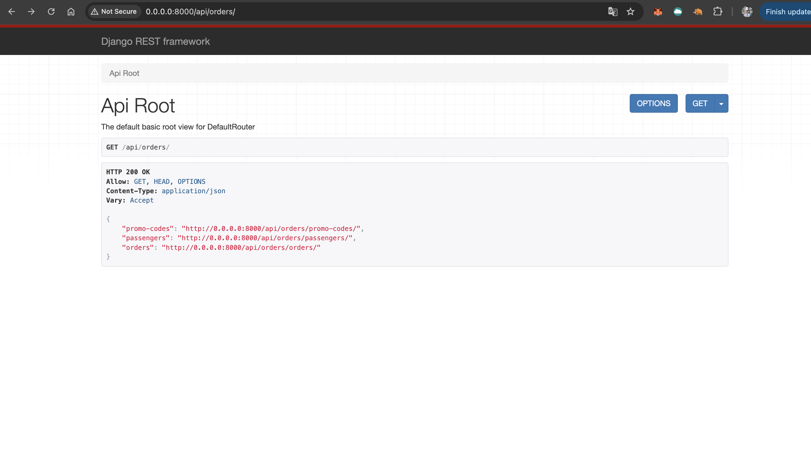
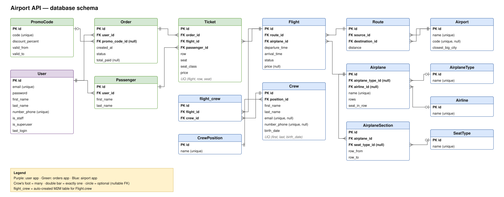

# ✈️ Airport API

REST API for an airport / airline booking service built with **Django REST Framework**.
Admins manage airports, routes, airplanes, crew and flights; users browse flights
and buy tickets for themselves and their passengers.

**Tech stack:** Python 3.13 · Django · Django REST Framework · MySQL · Docker · JWT (Simple JWT) · drf-spectacular (Swagger)

---

## Features

### Booking logic (orders app)
- **Several tickets in one order** — one request, one database transaction:
  if any ticket is invalid, nothing is saved.
- **Seat validation** — the row must exist in the airplane, the seat must fit the row,
  the seat must be free, and the same seat can't be booked twice in one order.
- **Flight checks** — tickets can only be bought for flights that are `scheduled` or `delayed`,
  have not departed yet and already have a price.
- **Price snapshot** — the server copies the flight price and the seat class (taken from the
  airplane section of the chosen row) into the ticket at the moment of purchase.
  The client can't set its own price or order status.
- **Promo codes** — percentage discount with validity dates; only active codes are accepted.
  Managed by admins only.
- **Privacy** — users see only their own orders and passengers; admins see all orders.

### Catalog (airport app)
- Airports, routes, airlines, airplane types, airplanes with seat sections
  (seat classes by rows), flights with statuses and crew.
- **Filtering** on list endpoints with input validation — an invalid filter value returns `400`
  with per-field errors instead of a server error.
- **Ordering** on list endpoints via `?ordering=<field>` (`-<field>` for descending).
- **Permissions** — everyone can read the catalog, only admins can change it.
  Crew data contains personal information and is admin-only.

### Other
- Custom user model with email login and JWT authentication.
- Interactive API documentation (Swagger UI).
- Tests for permissions, filters, validation and the booking logic.

---

## Getting started

### Requirements
- [Docker](https://docs.docker.com/get-docker/) and Docker Compose

### Run locally

```bash
git clone https://github.com/viloker/AirPort_API.git
cd AirPort_API

cp .env.sample .env   # fill in the values, see the table below

docker compose up --build
```

The API is available at **http://localhost:8000/**. Migrations are applied automatically on start.

### Environment variables

| Variable | Description |
|---|---|
| `SECRET_KEY` | Django secret key |
| `DEBUG` | `True` for local development, `False` in production |
| `MYSQL_DATABASE` | MySQL database name |
| `MYSQL_USER` | MySQL user |
| `MYSQL_PASSWORD` | MySQL user password |
| `MYSQL_ROOT_PASSWORD` | MySQL root password |
| `HOST` | Database host, `db` inside Docker |
| `PORT` | Database port, `3306` |

### Load demo data

The database starts empty. To try the API right away, load the demo fixture
(run it in a second terminal while `docker compose up` is running):

```bash
docker compose exec backend python manage.py loaddata fixtures/demo_data.json
```

It adds 6 airports, 8 routes, 3 airlines, 4 airplanes with seat sections
(Business / Premium Economy / Economy), crew, 12 flights in March 2027
(including a delayed, a cancelled and a "not on sale yet" flight without a price),
promo codes and a demo order.

| Account | Email | Password |
|---|---|---|
| Admin | `admin@airport.com` | `admin12345` |
| User | `demo@airport.com` | `demo12345` |

> Load the fixture into an **empty** database: it uses fixed ids and would overwrite existing rows.
> To start from scratch: `docker compose down -v && docker compose up --build`
> (`-v` deletes all database data).

Promo codes in the fixture: `AUTUMN10` (active, 10 %) and `SUMMER25` (expired — use it to see the validation error).

### Create your own admin

If you don't use the demo data:

```bash
docker compose exec backend python manage.py createsuperuser
```

Then add airports, airplanes, seat sections, routes and flights through Swagger UI
or the Django admin at `/admin/`.

### Run tests

```bash
docker compose exec backend python manage.py test
```

---

## Getting access

1. **Register** — `POST /api/user/register/`
   ```json
   {"email": "user@example.com", "password": "your-password"}
   ```
2. **Get a token** — `POST /api/user/token/`
   ```json
   {"email": "user@example.com", "password": "your-password"}
   ```
   The response contains an `access` token (valid for 5 minutes) and a `refresh` token (valid for 1 day).
3. **Send the token** with every request:
   ```
   Authorization: Bearer <access token>
   ```
   In Swagger UI click **Authorize** and paste `Bearer <access token>`.
4. **Refresh the token** when it expires — `POST /api/user/refresh-token/` with `{"refresh": "<refresh token>"}`.
5. **Your profile** — `GET /api/user/me/`

To manage the catalog (airports, flights, …) use an admin account: the demo admin or one created with `createsuperuser`.

---

## API documentation

| URL | |
|---|---|
| `/api/schema/swagger-ui/` | Swagger UI — try every endpoint in the browser |
| `/api/schema/` | OpenAPI schema |

### Endpoints

**Airport** — `/api/airport/`

| Endpoint | Filters (`?param=`) | Ordering |
|---|---|---|
| `airports/` | `name`, `code` | `name`, `code` |
| `routes/` | `source`, `destination` (airport id) | `source__name`, `destination__name` |
| `airlines/` | `name` | `name` |
| `airplane-types/` | `name` | `name` |
| `airplanes/` | `name`, `airline`, `airplane_type` | `name` |
| `seat-types/` | `name` | `name` |
| `airplane-sections/` | `airplane` | — |
| `flights/` | `source`, `destination` (airport id), `departure`, `arrival` (`YYYY-MM-DD`), `status` | `departure_time`, `arrival_time` |
| `crew-positions/` | `name` | `name` |
| `crew/` *(admin only)* | `first_name`, `last_name`, `position` | `first_name`, `last_name`, `birth_date` |

Example: `GET /api/airport/flights/?source=1&departure=2026-11-10&ordering=departure_time`

**Orders** — `/api/orders/`

| Endpoint | Access | Description |
|---|---|---|
| `orders/` | authenticated | list own orders, create an order |
| `orders/<id>/` | authenticated | own order with full ticket details |
| `passengers/` | authenticated | CRUD for own passengers |
| `promo-codes/` | admin | CRUD |

**User** — `/api/user/`

| Endpoint | Description |
|---|---|
| `register/` | create an account |
| `token/` | get an access and a refresh token |
| `refresh-token/` | get a new access token |
| `me/` | current user's profile |

### Example: buy tickets

`POST /api/orders/orders/`

```json
{
  "promo_code": "AUTUMN10",
  "tickets": [
    {"flight": 4, "row": 12, "seat": 3, "passenger": 7},
    {"flight": 4, "row": 12, "seat": 4, "passenger": 8}
  ]
}
```

The response contains the created order with ticket details, prices and the total with the discount.

If a seat is already taken, the error points to the exact ticket:

```json
{"tickets": {"0": {"seat": ["Seat 12-3 is already taken"]}}}
```

---

## Screenshots

Browsable API pages with the demo data loaded.

**Airport API root — all catalog endpoints**



**Flight list**



**Airplane sections — seat classes by rows**



**Seat types**



**Airplane types**



**Airlines**



**Crew positions**



**Crew list is admin-only — anonymous users get `401`**


**Orders API root**



---

## Database schema



The editable draw.io file: [`docs/airport_api_schema.drawio`](docs/airport_api_schema.drawio)

---

## Roadmap

- Order payment and cancellation
- Automatic cancellation of unpaid orders (Celery)
- Seat map endpoint for a flight
- Different prices per seat class